# NVIC, July 11, 2026 (Waking the M33)

On Cortex-M, the NVIC handles interrupts.

The Consortium IPC handshake graph is as follows:

```
┌──────────┐                                 ┌──────────┐
│          │    step 1. init descriptor      │          │
│          │————————————————————————————————>│          │
│ Cortex-A │       fires an interrupt        │ Cortex-M │
│          │                                 │          │
│          │    step 2. ack descriptor       │          │
│ (AP)     │<————————————————————————————————│ (CM7)    │
│          │      fires an interrupt         │ OR       │
│          │                                 │ (CM33)   │
└──────────┘                                 └──────────┘
```

The interrupt-handling paths are:

- **Cortex-A**, running a rich OS (Linux/OP-TEE). We primarily use [`uio`](https://www.kernel.org/doc/html/v4.18/driver-api/uio-howto.html) for Linux I/O on `BellA` (a Type-A doorbell). The path is:

  ```
  GIC -> Kernel --uio_pdrv_genirq--> /dev/uio2 -> Userspace Code (Consortium) running root
  ```

- **Cortex-M**, running bare-metal software (Embassy/RTIC). This is where the NVIC comes into effect:

  ```
  NVIC -> vector table (.isr_vectors) -> interrupt handler.
  ```

On Cortex-M, the vector table is stored in `.isr_vectors`, as established in [the previous log](jul-10-rproc.md).

## The Problem

While debugging the Cortex-M firmware, execution appeared to stop after the following log output:

```
root@stm32mp2-e3-cb-5f:~# ./consortium-example-defmt-host 0
CDBG uio0: mapped_len=0x2000 capacity=0x2000 read_ptr=0x10 write_ptr=0x71 pending~=0x61 flags=Flags(0x0)
drained 10 CDBG packet(s), 57 payload byte(s) total
packet 0: 4 byte(s) [00 11 7e 00]
consortium controller init: time driver bring-up
packet 1: 8 byte(s) [0a 01 05 3a 20 44 67 00]
consortium controller init: RCC register block at 0x44200000
packet 2: 4 byte(s) [0d 02 7a 00]
consortium controller init: TIM2 clock enabled
packet 3: 4 byte(s) [0e 03 7a 00]
consortium controller init: TIM2 timer driver initialized
packet 4: 4 byte(s) [0c 04 7a 00]
consortium controller init: TIM2 IRQ priority set to 0x80
packet 5: 4 byte(s) [0b 05 7a 00]
consortium controller init: TIM2 IRQ enabled/unmasked
packet 6: 8 byte(s) [2f 06 7a 06 10 80 78 00]
vtor value=2148533760
packet 7: 4 byte(s) [10 07 7a 00]
consortium controller init: mpu/nvic bring-up
packet 8: 4 byte(s) [12 08 7a 00]
peripherals stolen
packet 9: 13 byte(s) [08 09 06 3a 05 40 06 1b 20 05 40 6c 00]
consortium controller init: MPU carveout 0 base=0x20064000 size=0x00004000
drained 10 CDBG packet(s): decoded 10 defmt frame(s), 0 decode error(s)
```

This output came from `fn init() -> IpcMemoryEndpoints` in `consortium.gen.rs`. The relevant function excerpt is:

```rust
#[cfg(target_arch = "arm")]
fn init() -> IpcMemoryEndpoints {
    ::consortium_runtime_mcu::log::trace!(
        "consortium controller init: mpu/nvic bring-up"
    );
    // SAFETY: `init` runs once during controller bring-up, in
    // privileged mode, before any other code touches the MPU.
    let mut __core = unsafe { ::cortex_m::Peripherals::steal() };
    ::consortium_runtime_mcu::log::trace!("peripherals stolen");
    // SAFETY: `init` holds exclusive privileged MPU access during
    // bring-up; `base`/`size` are this core's validated shared
    // region from the Consortium hardware layout.
    unsafe {
        ::consortium_runtime_mcu::mpu::disable_cache(
            &mut __core.MPU,
            0u8,
            537280512u32,
            16384u32,
        );
        ::consortium_runtime_mcu::log::trace!(
            "consortium controller init: MPU carveout {} base={:#010x} size={:#010x}",
            0u8, 537280512u32, 16384u32
        );
    }
    #[derive(Clone, Copy, Debug, Eq, PartialEq)]
    #[repr(u16)]
    pub enum BellaInterrupt {
        IPCC1 = 171u16,
    }
    unsafe impl ::cortex_m::interrupt::InterruptNumber for BellaInterrupt {
        fn number(self) -> u16 {
            self as u16
        }
    }
    // SAFETY: interrupt numbers are emitted from the validated
    // Consortium hardware database for this visible core.
    unsafe {
        ::consortium_hal_stm32mp2::hal::nvic::set_priority(
            BellaInterrupt::IPCC1 as u16,
            0x80,
        );
    }
    // SAFETY: interrupt numbers are emitted from the validated
    // Consortium hardware database for this visible core.
    unsafe {
        ::cortex_m::peripheral::NVIC::unmask(BellaInterrupt::IPCC1);
    }
    ::consortium_runtime_mcu::log::trace!(
        "consortium controller init: NVIC unmask {} (id={})", stringify!(IPCC1),
        BellaInterrupt::IPCC1 as u32
    );
    IpcMemoryEndpoints::new()
}
```

## Progress 1: Execution Stops While Unmasking the NVIC

Because the next log message never appeared, the initial assumption was that execution stopped during the unmask operation:

```rust
unsafe {
    ::cortex_m::peripheral::NVIC::unmask(BellaInterrupt::IPCC1);
}
```

However, the `cortex-m` [source code](https://docs.rs/cortex-m/latest/src/cortex_m/peripheral/nvic.rs.html#115-122) shows that this operation is only an MMIO write:

```rust
    /// Enables `interrupt`
    ///
    /// This function is `unsafe` because it can break mask-based critical sections
    #[inline]
    pub unsafe fn unmask<I>(interrupt: I)
    where
        I: InterruptNumber,
    {
        let nr = interrupt.number();
        // NOTE(ptr) this is a write to a stateless register
        (*Self::PTR).iser[usize::from(nr / 32)].write(1 << (nr % 32))
    }
```

## Hypothesis 0: Four Possible Causes

Four possible explanations could account for execution stopping at the write:

1. A `HardFault`, for example because of an unaligned write or execution in user mode. This was inconsistent with the LED remaining on, based on the handlers described in [the previous log](jul-10-rproc.md).
2. A panic, for example because `usize::from(nr / 32)` exceeded the ISER array length. This was also inconsistent with the LED remaining on.
3. An infinite loop.
4. Disabling the cache through the MPU made the region unreadable. This was doubtful because logs could be written after the region was marked non-cacheable and read afterward.

## Contradiction: `TIM2` Works Normally

The log showed that `TIM2` was unmasked successfully. We therefore compared the `TIM2` initialization code:

```rust
fn init_time_driver() {
    consortium_runtime_mcu::log::trace!("consortium controller init: time driver bring-up");
    // STM32MP257F CM33 non-secure CMSIS names this TIM2_BASE_NS and TIM2_IRQn.
    // The boot/runtime handoff must leave TIM2's kernel clock at this rate.
    // SAFETY: RCC_BASE_NS is the STM32MP257F non-secure RCC register block.
    let rcc = unsafe { consortium_hal_stm32mp2::pac::peripherals::rcc::RCC::from_ptr(RCC_BASE_NS) };
    consortium_runtime_mcu::log::trace!(
        "consortium controller init: RCC register block at {:#010x}",
        RCC_BASE_NS as u32
    );
    rcc.TIM2CFGR().modify(|w| {
        w.set_TIM2RST(false);
        w.set_TIM2EN(true);
        w.set_TIM2LPEN(true);
    });
    consortium_runtime_mcu::log::trace!("consortium controller init: TIM2 clock enabled");

    // SAFETY: TIM2 is reserved for this demo firmware and clocked above; the
    // IRQ handler below forwards TIM2_IRQn to the HAL time driver.
    unsafe {
        consortium_hal_stm32mp2::timer_driver::init_timer(TIM2_BASE_NS, TIM2_CLOCK_HZ);
    }
    consortium_runtime_mcu::log::trace!(
        "consortium controller init: TIM2 timer driver initialized"
    );
    unsafe {
        consortium_hal_stm32mp2::hal::nvic::set_priority(TIM2_IRQ, 0x80);
    }
    consortium_runtime_mcu::log::trace!(
        "consortium controller init: TIM2 IRQ priority set to 0x80"
    );
    unsafe {
        consortium_hal_stm32mp2::hal::nvic::enable(TIM2_IRQ);
    }
    consortium_runtime_mcu::log::trace!("consortium controller init: TIM2 IRQ enabled/unmasked");
}
```

[`consortium_hal_stm32mp2::hal::nvic::enable`](https://github.com/consortium-rs/consortium/blob/82fff75b4c3469e48242c915bb89836199d270a8/crates/consortium-hal/src/nvic.rs#L34) is only a wrapper around `NVIC::unmask`:

```rust
/// Enable (unmask) an interrupt.
///
/// # Safety
///
/// Enabling an interrupt may break mask-based critical sections and requires
/// that a handler for it is installed in the active vector table.
pub unsafe fn enable(irq: u16) {
    // SAFETY: Propagates the caller's critical-section/handler contract.
    unsafe { NVIC::unmask(Irq(irq)) }
}
```

The two paths used the same setup and underlying operation, yet only one appeared to stop.

We checked the IRQ table again in [RM0457](https://www.st.com/resource/en/reference_manual/rm0457-stm32mp2325xx-advanced-armbased-3264bit-mpus-stmicroelectronics.pdf), using page 1739 for `TIM2`:

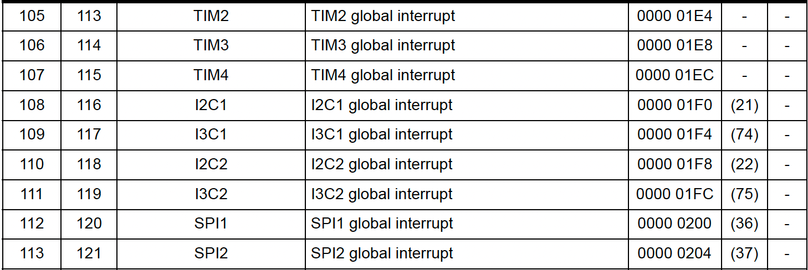

Page 1741 lists `IPCC1_RX`:

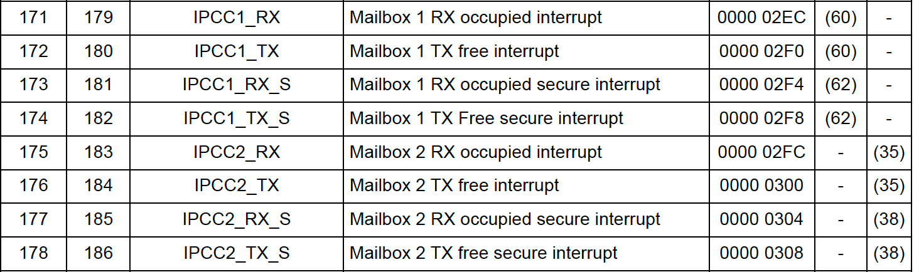

The IRQ numbers were correct, so the discrepancy required another explanation.

## Hypothesis 1: A Previously Pending Interrupt Caused Recursion

To test this hypothesis, we added an `unpend` operation before unmasking:

```rust
::cortex_m::peripheral::NVIC::unpend(BellaInterrupt::IPCC1);
```

This should prevent the NVIC from taking an already pending interrupt immediately after unmasking. It did not change the result: execution still stopped after `unpend` and before `unmask` returned.

## Hypothesis 2: EXTI Routing

Unlike `TIM2`, `IPCC1_RX` has an `EXTI1` path. We used `devmem2` to inspect the relevant EXTI registers.

1. Read `EXTI1_C{m}IMR2`.

   Because `m=1` corresponds to the A35 and the M33's `m=2` register is inaccessible from the A35, we first read `EXTI1_C1IMR2`.

   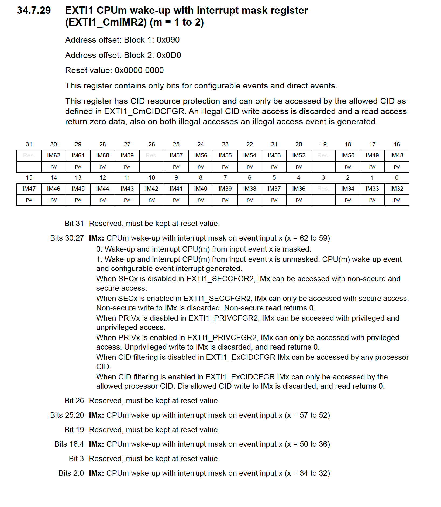

   ```sh
   root@stm32mp2-e3-cb-5f:~# devmem2 0x44220090 w
   /dev/mem opened.
   Memory mapped at address 0xffffab04b000.
   Read at address  0x44220090 (0xffffab04b090): 0x00003800
   ```

   This value showed that:

   ```js
   > 0x00003800 & (1 << 28)
   0
   ```

   Bit `28` (IM60) was `0`.

2. Read `EXTI1_RPR2`.

   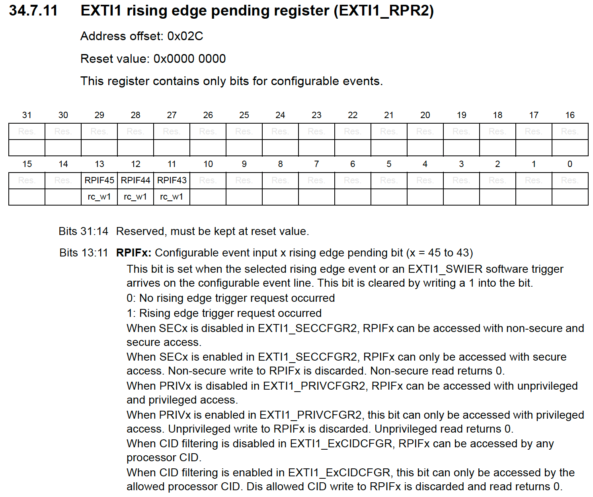

   ```
   root@stm32mp2-e3-cb-5f:~# devmem2 0x4422002c w
   /dev/mem opened.
   Memory mapped at address 0xffffbd3e2000.
   Read at address  0x4422002C (0xffffbd3e202c): 0x00000000
   ```

   The register was entirely zero.

3. Read `EXTI1_FPR2`.

   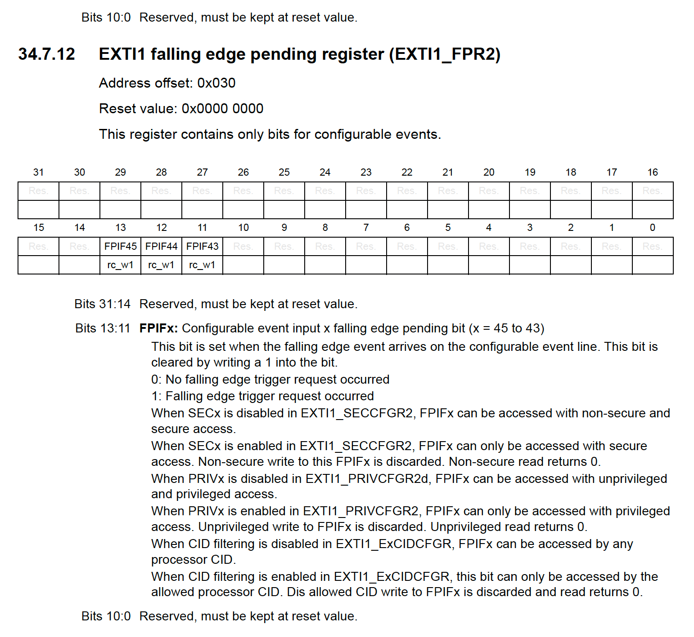

   ```
   root@stm32mp2-e3-cb-5f:~# devmem2 0x44220030 w
   /dev/mem opened.
   Memory mapped at address 0xffffae16e000.
   Read at address  0x44220030 (0xffffae16e030): 0x00000000
   ```

   The register was entirely zero.

This did not explain the failure: both `EXTI1_FPR2` and `EXTI1_RPR2` mark the `IM60` bit as reserved. The EXTI state showed the `IPCC1_RX` path as masked and clear, directing the investigation back to the on-chip NVIC rather than a missing EXTI direction. The EXTI hypothesis was therefore rejected.

## Hypothesis 3: A Problem in the `cortex-m` Call

To exclude a problem in the `cortex-m` crate call, we replaced it with a direct MMIO write:

```rust
defmt::info!("before iser write");
unsafe {
    core::ptr::write_volatile(0xE000_E114 as *mut u32, 1u32 << 11);
}
defmt::info!("after iser write");
```

The result was:

```
packet 10: 4 byte(s) [2f 0a 7a 00]
before iser write
drained 11 CDBG packet(s): decoded 11 defmt frame(s), 0 decode error(s)
root@stm32mp2-e3-cb-5f:~#
```

Adding a marker write of `0x0926` to `0x20064000` in the IPC section also produced no observable indication.

```
root@stm32mp2-e3-cb-5f:~# ./2607092332_uio_batch /dev/uio1 r 0x0
/dev/uio1 [window 0] offset 0x0 (4 bytes):
  0x0000: 43 50 49 43
As ASCII:
  "CPIC"
As 32-bit words:
  0x0000: 43495043
root@stm32mp2-e3-cb-5f:~# ./2607092332_uio_batch /dev/uio0 r 0x0
/dev/uio0 [window 0] offset 0x0 (4 bytes):
  0x0000: 47 42 44 43
As ASCII:
  "GBDC"
As 32-bit words:
  0x0000: 43444247
```

ISER5 is selected because `171 / 32 = 5`, with bit `171 % 32 = 11`. This write replaced `NVIC::unmask`; it was not added alongside it, so the raw write was tested independently of the wrapper.

## Progress 2: The IPCC Interrupt _Should_ Be Generated

1. The `IPCC_C1MR` word indicates the mask:

   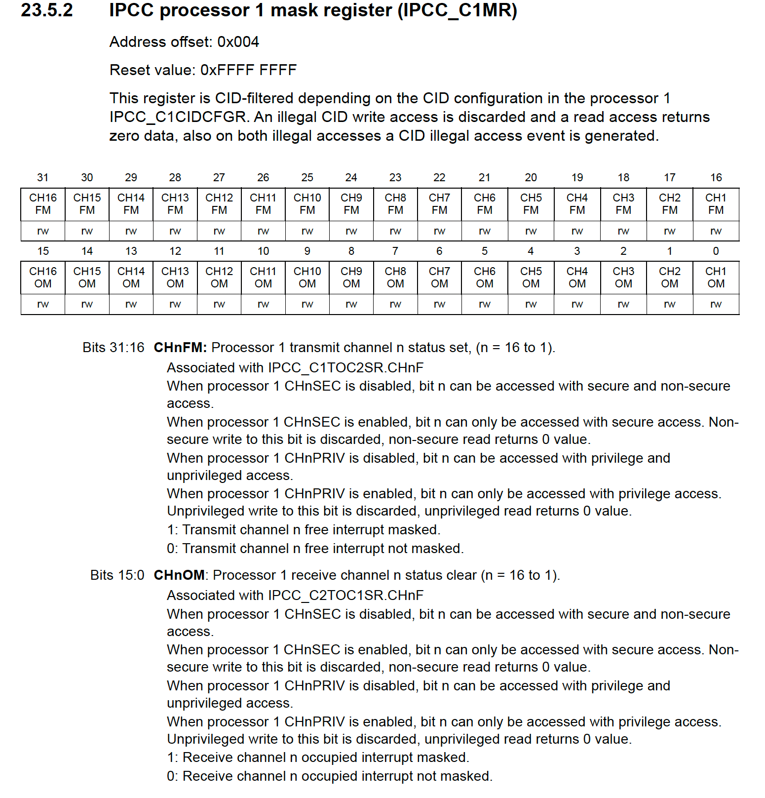

   ```
   /* (IPCC1) IPCC_C1MR */
   root@stm32mp2-e3-cb-5f:~# devmem2 0x40490004 w
   /dev/mem opened.
   Memory mapped at address 0xffff93a27000.
   Read at address  0x40490004 (0xffff93a27004): 0x0FFF0FFD
   ```

2. The `IPCC_C1TOC2SR` word indicates the state:

   
   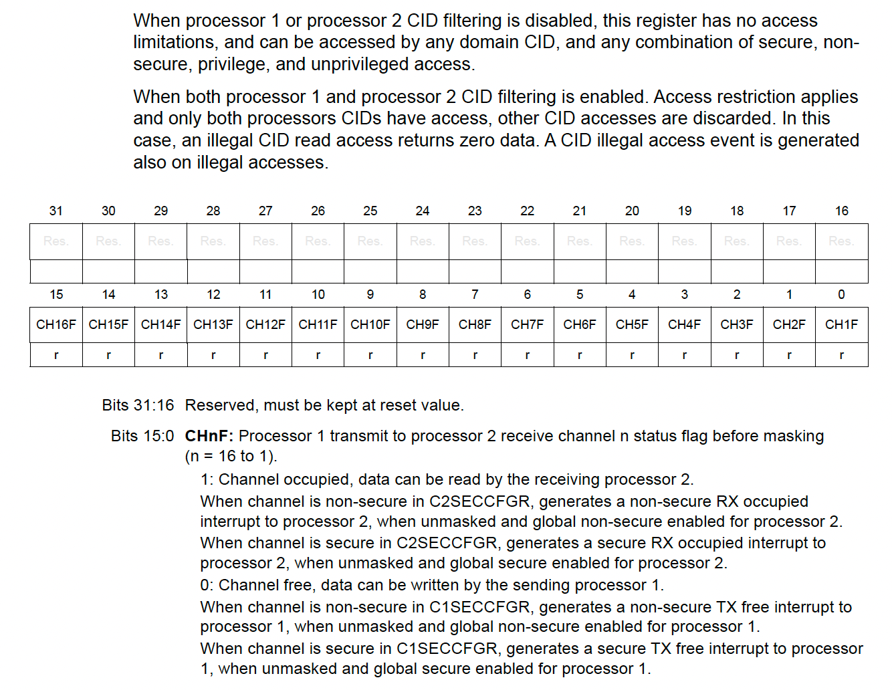

   ```
   root@stm32mp2-e3-cb-5f:~# devmem2 0x4049000c w
   /dev/mem opened.
   Memory mapped at address 0xffffb493d000.
   Read at address  0x4049000C (0xffffb493d00c): 0x00000001
   ```

   Therefore, the interrupt _should_ be asserted.

## Hypothesis 3: An IPCC Clock Issue

Unlike the `TIM2` initialization, the IPCC path did not explicitly configure the RCC. The peripheral therefore might not have worked for the M33 because it had not been powered in the M33's domain.

This hypothesis was weak, however. As described in [the earlier UIO investigation](jul-9-uio.md), assigning `clocks` to `IPCC1` in the Linux DTS powered it; without that assignment, access produced a `Bus error`.

To determine whether the M-core could reset the `IPCC1` peripheral, we inspected `RCC_IPCC1CFGR` on page 1172.

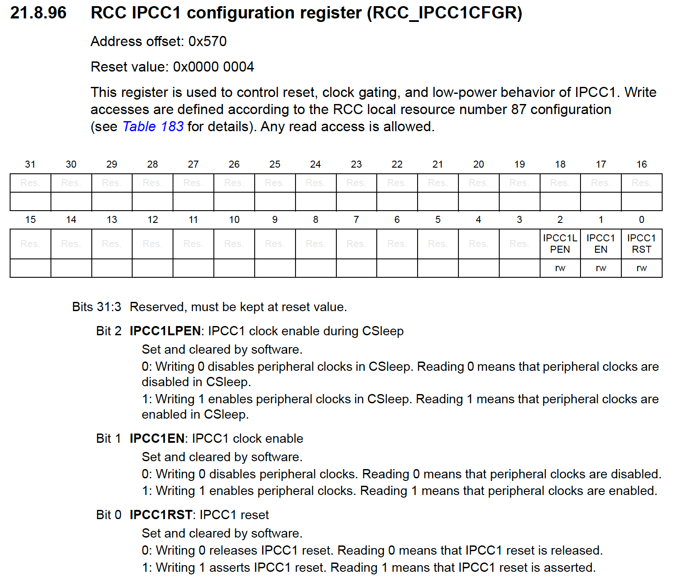

```
root@stm32mp2-e3-cb-5f:~# devmem2 0x44200570 w
/dev/mem opened.
Memory mapped at address 0xffff9510a000.
Read at address  0x44200570 (0xffff9510a570): 0x00000006
```

Both `IPCC1LPEN` and `IPCC1EN` were `true`, confirming that the clock was enabled.

We then identified the register that controls access to `RCC_IPCC1CFGR` on page 1075:

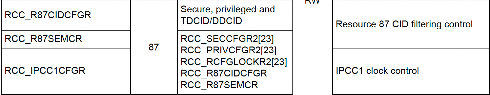

`RCC_IPCC1CFGR` is managed by `RCC_R87CIDCFGR`.

Page 1088 defines `RCC_R87CIDCFGR` as follows:

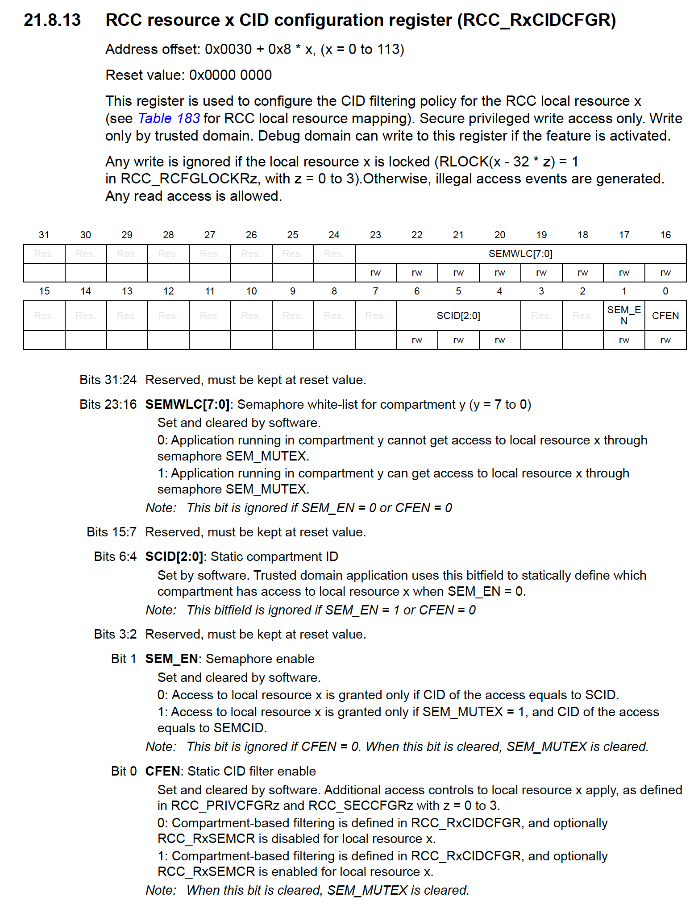

```
root@stm32mp2-e3-cb-5f:~# devmem2 0x442002e8 w
/dev/mem opened.
Memory mapped at address 0xffffbb8fe000.
Read at address  0x442002E8 (0xffffbb8fe2e8): 0x00020003
```

Here, `CFEN=1` (bit 0), `SEM_EN=1` (bit 1), and `SEMWLC[7:0]=0x02` (bit 17 of the full register, the whitelist bit for compartment 1). The SCID bits are ignored because `SEM_EN=1`. According to the specification, these fields govern write access to `RCC_IPCC1CFGR` itself: they determine which CID may take the semaphore to enable, disable, or reset the `IPCC1` clock. They do not govern access to the IPCC peripheral's own registers or to anything in the CM33's core-private address space.

The clock hypothesis was therefore rejected.

## Hypothesis 4: Firmware `VTOR` Table Corruption

To investigate this possibility, we added the following statement:

```rust
    let vtor = unsafe { &*(cortex_m::peripheral::SCB::PTR) }.vtor().read();
    consortium_runtime_mcu::log::trace!("vtor value={}", vtor);
```

The result was:

```
vtor value=2148533760
```

(= 0x8010_0000)

This matched `m33-cube-fw` in the DTS, confirming that the value was correct. The `VTOR`-corruption hypothesis was rejected.

## Hypothesis 5: Missing NVIC Priority Configuration

The MSP initialization from STM32CubeMX contains `HAL_NVIC_SetPriority` and `HAL_NVIC_EnableIRQ`.

```c

/**
  * @brief IPCC MSP Initialization
  * This function configures the hardware resources used in this example
  * @param hipcc: IPCC handle pointer
  * @retval None
  */
void HAL_IPCC_MspInit(IPCC_HandleTypeDef* hipcc)
{
  if(hipcc->Instance==IPCC1)
  {
    /* USER CODE BEGIN IPCC1_MspInit 0 */

    /* USER CODE END IPCC1_MspInit 0 */
    /* IPCC1 interrupt Init */
    HAL_NVIC_SetPriority(IPCC1_RX_IRQn, 1, 0);
    HAL_NVIC_EnableIRQ(IPCC1_RX_IRQn);
    /* USER CODE BEGIN IPCC1_MspInit 1 */

    /* USER CODE END IPCC1_MspInit 1 */

  }

}
```

We added:

```rust
    // SAFETY: interrupt numbers are emitted from the validated
    // Consortium hardware database for this visible core.
    unsafe {
        ::consortium_hal_stm32mp2::hal::nvic::set_priority(
            BellaInterrupt::IPCC1 as u16,
            0x80,
        );
    }
```

Execution still stopped while unmasking the interrupt.

## Experiment: `TIM6`

To determine whether this behavior was specific to IPCC or affected other interrupts, I tested `TIM6`, which is also assigned to the M33:

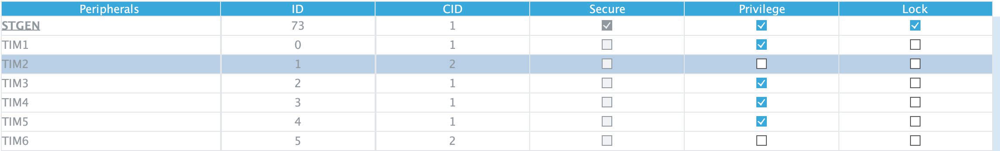

### Cold Start: Execution Stops

Following the `TIM2` example, I added the following setup code:

```rust
fn init_time_driver() {
    consortium_runtime_mcu::log::trace!("consortium controller init: time driver bring-up");
    // STM32MP257F CM33 non-secure CMSIS names this TIM2_BASE_NS and TIM2_IRQn.
    // The boot/runtime handoff must leave TIM2's kernel clock at this rate.
    // SAFETY: RCC_BASE_NS is the STM32MP257F non-secure RCC register block.
    let rcc = unsafe { consortium_hal_stm32mp2::pac::peripherals::rcc::RCC::from_ptr(RCC_BASE_NS) };
    consortium_runtime_mcu::log::trace!("consortium controller init: RCC register block at {:#010x}", RCC_BASE_NS as u32);
    rcc.TIM2CFGR().modify(|w| {
        w.set_TIM2RST(false);
        w.set_TIM2EN(true);
        w.set_TIM2LPEN(true);
    });
    consortium_runtime_mcu::log::trace!("consortium controller init: TIM2 clock enabled");

    consortium_runtime_mcu::log::trace!("test unmask tim6 irq start");
    unsafe {
        consortium_hal_stm32mp2::hal::nvic::enable(consortium_hal_stm32mp2::Interrupt::TIM6 as u16);
    }
    consortium_runtime_mcu::log::trace!("test unmask tim6 irq stop");
```

The result was:

```
root@stm32mp2-e3-cb-5f:~# ./consortium-example-defmt-host 0
CDBG uio0: mapped_len=0x2000 capacity=0x2000 read_ptr=0x10 write_ptr=0x34 pending~=0x24 flags=Flags(0x0)
drained 4 CDBG packet(s), 20 payload byte(s) total
packet 0: 4 byte(s) [00 13 7e 00]
consortium controller init: time driver bring-up
packet 1: 8 byte(s) [0c 01 05 3a 20 44 67 00]
consortium controller init: RCC register block at 0x44200000
packet 2: 4 byte(s) [0f 02 7a 00]
consortium controller init: TIM2 clock enabled
packet 3: 4 byte(s) [17 03 7a 00]
test unmask tim6 irq start
drained 4 CDBG packet(s): decoded 4 defmt frame(s), 0 decode error(s)
```

Execution stopped again.

### Adding the Clock: Execution Still Stops

We added the clock-setup code:

```rust
    rcc.TIM6CFGR().modify(|w| {
        w.set_TIM6RST(false);
        w.set_TIM6EN(true);
        w.set_TIM6LPEN(true);
    });
```

The result did not change:

```
packet 3: 4 byte(s) [17 03 7a 00]
test unmask tim6 irq start
packet 4: 4 byte(s) [18 04 7a 00]
test unmask tim6 irq start: rcc done
drained 5 CDBG packet(s): decoded 5 defmt frame(s), 0 decode error(s)
root@stm32mp2-e3-cb-5f:~#
```

### Adding a Handler: Execution Still Stops

We added the following handler:

```rust
#[interrupt]
fn TIM6() {
    unsafe { core::ptr::write_volatile(0x442b_0028 as *mut u32, 1u32 << 6); }
}
```

The LED remained on, indicating that the interrupt handler had not been entered.

## Hypothesis 6: A Flat `NVIC/ISER` Implementation Limit at IRQ128 (ISER4+)

Because TIM2 (105) worked while TIM6 (128) and IPCC1 (171) stopped, we inspected the ICTR value:

```rust
let ictr = unsafe { core::ptr::read_volatile(0xE000_E004 as *const u32) };
defmt::info!("ICTR={:#010x} intlinesnum={=u32}", ictr, ictr & 0xF);
```

The result was:

```
ICTR=0x00000009 intlinesnum=9
```

`ICTR=0x9` means `INTLINESNUM=9`, giving `32 × (9+1) = 320` implemented interrupt lines. Therefore, `ISER0..ISER9` are backed by hardware. Both `IRQ128` (`ISER4`) and `IRQ171` (`ISER5`) are within this range, ruling out an unimplemented-ISER-register explanation.

## Hypothesis 7: An Unconfigured `AIRCR`

`HAL_NVIC_SetPriorityGrouping()` writes `SCB->AIRCR` with `VECTKEY` (`0x05FA` in the upper halfword) to configure the priority-grouping split. Our `init()` did not modify AIRCR, leaving priority grouping at either the value configured by the boot chain or its architectural reset value.

```rust
unsafe {
    core::ptr::write_volatile(0xE000_ED0C as \*mut u32, (0x5FA << 16) | (3 << 8)); // AIRCR, VECTKEY + PRIGROUP=3
}
defmt::info!("aircr set");
```

The result was:

```
packet 3: 4 byte(s) [14 03 7a 00]
consortium controller init: setting AIRCR (for testing)
packet 4: 4 byte(s) [08 04 7a 00]
consortium controller init: AIRCR set
packet 5: 4 byte(s) [19 05 7a 00]
test unmask tim6 irq start
packet 6: 4 byte(s) [1a 06 7a 00]
test unmask tim6 irq start: rcc done
drained 7 CDBG packet(s): decoded 7 defmt frame(s), 0 decode error(s)
root@stm32mp2-e3-cb-5f:~#
```

This change also had no effect.

## Hypothesis 8: The IPCC Doorbell Was Not Cleaned Up

Using Embassy's `IPCC` implementation as a reference, we reimplemented the `no_std` wake mechanism:

```rust
pub unsafe fn notify_rx_occupied_interrupt<S: Side, const N: usize>(
    base: usize,
) {
    let ipcc = unsafe { Ipcc::<S, N>::new(base) };
    let occupied = ipcc.incoming_occupied_channels();

    ipcc.mask_rx_occupied_channels(occupied);

    for id in 0..IPCC_CHAN_COUNT {
        if occupied & (1 << id) != 0 {
            channel_waker::<N>(id).wake();
        }
    }
}

#[interrupt]
fn IPCC1_RX() {
    on_rx_occupied_interrupt::<Secondary, 1>()
}
```

Execution still stopped at the same point.

## Progress 3: Distinguishing `HardFault` from `IRQ`

Even direct bare-metal access did not work:

```rust
#[interrupt]
fn IPCC1_RX() {
    unsafe {
        // Marker first.
        core::ptr::write_volatile(0x2006_4000 as *mut u32, 0x0926);

        // C2MR.CH0OM = 1: mask CM33 RX-occupied channel 0.
        let c2mr = 0x4049_0014 as *mut u32;
        let value = core::ptr::read_volatile(c2mr);
        core::ptr::write_volatile(c2mr, value | 1);
    }
}
```

The memory contained:

```
root@stm32mp2-e3-cb-5f:~# ./2607092332_uio_batch /dev/uio1 r 0x0
/dev/uio1 [window 0] offset 0x0 (4 bytes):
  0x0000: 43 50 49 43
As ASCII:
  "CPIC"
As 32-bit words:
  0x0000: 43495043
```

Because `0x0926` was absent at `0x2006_4000`, the `#[interrupt]` handler had not executed.

To identify which path was actually taken, we split the handling logic between `#[interrupt] fn IPCC_RX()` and `#[cortex_m_rt::exception] unsafe fn DefaultHandler(irqn: i16)`.

### `IPCC1_RX` Interrupt

```rust
#[consortium_hal_stm32mp2::interrupt]
fn IPCC1_RX() {
    unsafe {
        core::ptr::write_volatile(0x442b_0028 as *mut u32, 1u32 << 6);
        core::ptr::write_volatile(0x2006_4000 as *mut u32, 0x0926);
    }

    unsafe {
        consortium_ipc_doorbell_ipcc::notify_rx_occupied_interrupt::<
            consortium_ipc::Secondary,
            1,
        >(0x4049_0000);
    }

    consortium_runtime_mcu::log::trace!(
        "ipcc1_rx interrupt: doorbell RX occupied"
    );
}
```

### `DefaultHandler` Exception

```rust
#[cortex_m_rt::exception]
unsafe fn DefaultHandler(_irqn: i16) {
    let icsr = unsafe { core::ptr::read_volatile(0xE000_ED04 as *const u32) };
    let vectactive = icsr & 0x1ff;

    // Dedicated diagnostic output; preserve the existing diagnostics too.
    unsafe {
        core::ptr::write_volatile(0x2006_4000 as *mut u32, 0xD000_0000 | vectactive);
        core::ptr::write_volatile(0x2006_4010 as *mut i16, irqn);
        core::ptr::write_volatile(0x442b_0028 as *mut u32, 1u32 << 6);
    }

    loop {
        core::hint::spin_loop();
    }
}
```

The LED then turned off, showing that either `IPCC1_RX` or `DefaultHandler` had been entered. We then extracted the recorded data:

```
root@stm32mp2-e3-cb-5f:~# devmem2 0x20064000 h
/dev/mem opened.
Memory mapped at address 0xffff8621c000.
Read at address  0x20064000 (0xffff8621c000): 0x00BB
root@stm32mp2-e3-cb-5f:~# devmem2 0x20064000 w
/dev/mem opened.
Memory mapped at address 0xffffb6342000.
Read at address  0x20064000 (0xffffb6342000): 0xD00000BB
root@stm32mp2-e3-cb-5f:~# devmem2 0x20064010 w
/dev/mem opened.
Memory mapped at address 0xffffb67ef000.
Read at address  0x20064010 (0xffffb67ef010): 0x98BE00AB
root@stm32mp2-e3-cb-5f:~# devmem2 0x20064010 h
/dev/mem opened.
Memory mapped at address 0xffff8c189000.
Read at address  0x20064010 (0xffff8c189010): 0x00AB
```

The recorded value `0x00ab` corresponds to:

```
VECTACTIVE = 0xBB = 187 = 16 + IRQ171
irqn       = 0xAB = 171
```

This confirmed that IRQ171 was taken and `DefaultHandler` executed. At this point, there was no remaining ambiguity about whether IPCC asserted the interrupt or the NVIC accepted it.

### Why Does It Enter `DefaultHandler`?

We inspected the current ELF:

```
VTOR                       0x80100600
IRQ171 slot                0x801008EC
ELF word at 0x801008EC     0x80100BB5
IPCC1_RX                   0x80100BB5
```

We read the vector entry from both cores to eliminate cache-coherency issues:

- A-core:

  ```sh
  root@stm32mp2-e3-cb-5f:~# devmem2 0x801008ec w
  /dev/mem opened.
  Memory mapped at address 0xffffaa860000.
  Read at address  0x801008EC (0xffffaa8608ec): 0x80100BB5
  ```

- M-core:

  ```rust
  let vector = unsafe {
      core::ptr::read_volatile(0x8010_08ec as *const u32)
  };

  defmt::info!("cm33 irq171 vector={=u32:#010x}", vector);

  cortex_m::asm::dsb();
  cortex_m::asm::isb();

  cortex_m::peripheral::NVIC::pend(
      consortium_hal_stm32mp2::Interrupt::IPCC1_RX,
  );
  ```

  Result:

  ```
  packet 20: 9 byte(s) [36 14 b5 3a 0b 10 80 78 00]
  cm33 irq171 vector=0x80100bb5
  drained 21 CDBG packet(s): decoded 21 defmt frame(s), 0 decode error(s)
  ```

The evidence was now:

```
VTOR written/read:             0x80100600
base with bit 0x200 removed:   0x80100400
IRQ171 offset:                 0x2EC
candidate fetch address:       0x801006EC
word at 0x801006EC:            0x80100B75
DefaultHandler:                0x80100B75
```

This exposed the problem: `0x80100400 + 0x2EC > 0x80100600`.

## Experiment: Whether Overflow Truncates Custom Interrupt Handler

The observed transition point could be tested precisely. Address `0x80100800` corresponds to exception number 128, which is external IRQ112:

```
IRQ111 I3C2 → vector at 0x801007FC, immediately below boundary
IRQ112 SPI1 → vector at 0x80100800, exactly at boundary
```

We therefore tested `I3C2` and `SPI1` on opposite sides of this boundary:

```rust
#[interrupt]
fn I3C2() {
    unsafe {
        core::ptr::write_volatile(0x2006_4014 as *mut u32, 0x1111_1111);
    }
}

#[interrupt]
fn SPI1() {
    unsafe {
        core::ptr::write_volatile(0x2006_4014 as *mut u32, 0x1121_1211);
    }
}

NVIC::unmask(Interrupt::I3C2);
NVIC::pend(Interrupt::I3C2);

NVIC::unmask(Interrupt::SPI1);
NVIC::pend(Interrupt::SPI1);
```

The test produced the following result:

```
packet 20: 9 byte(s) [3b 14 c9 3a 0b 10 80 78 00]
cm33 irq171 vector=0x80100bc9
packet 21: 4 byte(s) [2a 15 7a 00]
test interrupt i3c2
packet 22: 4 byte(s) [2b 16 7a 00]
test interrupt i3c2 unmasked
packet 23: 4 byte(s) [2c 17 7a 00]
test interrupt spi1
packet 24: 4 byte(s) [2d 18 7a 00]
test interrupt spi1 unmasked
drained 25 CDBG packet(s): decoded 25 defmt frame(s), 0 decode error(s)
```

This confirmed the exact boundary:

- `IRQ111` (`I3C2`, exception `127`, last word before `0x80100800`) executes correctly.
- `IRQ112` (`SPI1`, exception `128`, first word at `0x80100800`) enters the wrong path and sticks.

We extended `NS_VECTOR_TBL`:

```link.x
NS_VECTOR_TBL: 0x80100000, length 0x800
FLASH:         0x80100800, length 0x7ff800
```

The resulting `.vector_table` was:

```
.vector_table address:  0x80100800
.vector_table size:     0x51c
IRQ171 slot:            0x80100aec
IRQ171 value:           0x80100dc9 → IPCC1_RX
.text starts:           0x80100d1c
```

After extending the vector-table region, the interrupt handler worked.
